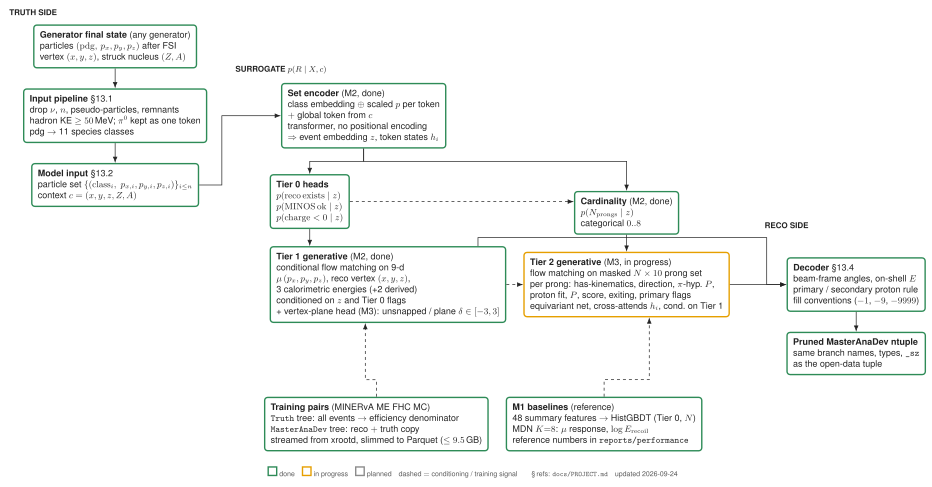

# opendata-sim2reco

An AI/ML surrogate for the MINERvA detector: per-event mapping from GENIE final-state truth to MasterAnaDev
reconstructed variables, trained on the [MINERvA open data](https://minerva.fnal.gov/opendata/) MC, built to
extrapolate to final states the released MC does not cover (alternative generators, higher multiplicity, new
kinematic regions).

Status: M0 (data pipeline), M1 (baselines) and M2 (set encoder + flow-matching surrogate, closure AUC 0.57) done; M3 (prong set model + vertex-plane head) done; 2p2h holdout done on playlist 1A; input definition adopted: 10 MeV threshold with neutron tokens (variant study in `reports/variants_1A`); Bayesian last layers give calibrated epistemic uncertainty (`reports/bayes_1A`). Out-of-support holdout next. Read [`docs/PROJECT.md`](docs/PROJECT.md) first; performance numbers are in `reports/performance/main.tex` (compiled with tectonic; describes the current model, not the milestone history).

## Model schematic



Architecture of the current surrogate (encoder, classification heads, vertex-plane head, event flow, prong set flow, decoder). Source: `docs/figures/model_schematic.tex` (TikZ); regenerate with `bash scripts/render_schematic.sh`.

## Quick start

```
bash scripts/setup_env.sh                                  # Python >= 3.9 venv with torch (CUDA), uproot, ...
source .venv/bin/activate
python scripts/slim_remote.py configs/MediumEnergy_FHC_StandardMC_Playlist1A.txt data/slim_1A --budget-gb 9.5
                                                           # stream from xrootd, 20 GB ROOT -> 300 MB Parquet per file
python scripts/dataset_summary.py data/slim_1A/<stem>      # population statistics of one slimmed file
bash scripts/pipeline_all.sh                               # the deployed chain: event stage (run_m2.py) -> prong stage (run_m3.py)
                                                           #   -> vertex head (pipeline_vz.sh) for the full model and the 2p2h holdout
bash scripts/pipeline_ensemble.sh                          # the three further ensemble members (seeds 1-3)
python scripts/surrogate_to_ntuple.py reports/m3_1A_all TRUTH.parquet out.root --ensemble reports/m3_1A_all_s1 reports/m3_1A_all_s2 reports/m3_1A_all_s3
                                                           # truth -> two-tree surrogate ntuple with the four universes (docs/surrogate_files.md)
python scripts/conform_ntuple.py out.root data/reference/MasterAnaDev_data_AnaTuple_run00010255_Playlist.root out_full.root --strict
                                                           # optional: full 3,687-branch schema + Meta tree, unmodelled branches at their sentinel defaults
bash scripts/pipeline_geo_2026-11.sh                       # the geometry-placed NuWro and GiBUU samples in slices (build_geo_truth.py, thin_geo_truth.py, merge_ntuples.py)
bash scripts/pipeline_paper_all.sh; bash scripts/pipeline_paper_fulltest.sh; bash scripts/pipeline_technote_all.sh   # paper and technote products
python scripts/export_open.py                              # the open release (XSuM-MINERvA)
pytest -q                                                  # round-trip and model tests on the example file
(cd reports/performance && tectonic -X compile main.tex)   # performance report (technote) PDF
```

## Layout

- `sim2reco/io/` — branch lists, ROOT -> Parquet slimming, pruned-ntuple writer.
- `sim2reco/prep/` — input pipeline (particle selection, context), canonical prong table encode/decode, muon decode, beam/detector frames.
- `sim2reco/data/` — torch dataset (padded particle sets, context, Tier 0/1 targets) and subrun-level splits.
- `sim2reco/models/` — set encoder, flow matching, surrogate (M2), MDN baseline (M1); `sim2reco/train/` — `baselines.py` (M1), `m2.py` (training + closure evaluation); `sim2reco/eval/` — metrics and plots.
- `sim2reco/data/compact.py` — ragged multi-file dataset and the Tier 1 transform (model space <-> tuple units).
- `scripts/` — curation, the training chain, inference, evaluation, paper and technote products, the open-release export; `scripts/bayes/` the Bayesian-last-layer study (kept as the technote's negative result); `scripts/retired/` finished studies and the pre-geometry generator placement, with a README (inputs no longer on disk).
- `reports/m1/` — M1 metrics, LaTeX tables, figures; `reports/performance/main.tex` — the performance report.
- `configs/data.yaml` — selection and split settings.
- `tests/` — pipeline and exact round-trip tests on the example ntuple.
- `docs/PROJECT.md` — project design: goal, inputs, conditioning, outputs, variable-length handling, extrapolation strategy, milestones, open questions.
- `docs/tuple_notes.md` — what is actually in the open-data MC AnaTuple, with measured numbers from one ME FHC file.
- `docs/branches/` — full branch lists of the `MasterAnaDev`, `Truth`, `Meta` trees, and a copy of the upstream `MAD_tuple_MainDoc.csv`.

## Data

Open-data AnaTuples are streamed from Fermilab's xrootd door and slimmed to Parquet under `data/slim/`
(not committed). No ROOT file needs to be stored locally; reading needs only `uproot`, `awkward` and the
`xrootd` Python bindings. Source: https://minerva.fnal.gov/getdata.

## Acknowledgment

The authors thank the MINERvA Collaboration for making their data, simulated data, and analysis tools available
to the community. Data release: https://doi.org/10.15484/3022562 (CC0).
